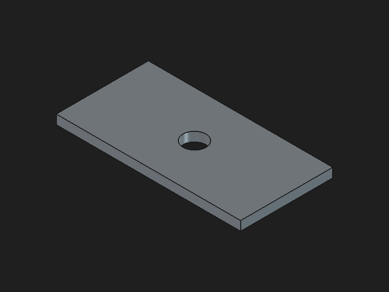

# Verification record

This is an experimental first release, with explicit separation between local/software evidence and physical printer evidence.

## 2026-09-07 initial run

| Stage | Evidence | Result |
| --- | --- | --- |
| Python package | Python 3.12, uv locked environment; wheel and sdist build | Passed locally on macOS ARM64 |
| MCP | Actual stdio initialization, tool list, capabilities call and blocked unapproved start | Passed; 12 tools |
| Offline behavior | CAD/preflight fixtures, FTPS/MQTT behavior, review, stale/busy/mismatched state, restart/no duplicate start, cross-job lease and completion attribution | Test suite in `tests/`; run `uv run --frozen pytest -q` |
| FreeCAD | 1.1.3 app + pinned FreeCADMCP addon; bundled plate script, named-solid validation and source-preserving export | FCStd/STL/STEP produced; CAD bounds 80 × 40 × 4 mm, volume 12485.840734641019 mm³ |
| Bambu Studio | 2.8.2 GUI; imported exported STL, Slice/Preview, first-layer inspection, plate export | A1 / 0.4 mm / Textured PEI Plate / Generic PLA; 20 layers; 20m59s; 8.37 g shown in GUI |
| Custom preflight | Immutable snapshot of that GUI export | Passed; single plate, project slot 0; first-layer nozzle 220°C, bed profile 65°C |
| CLI presets | Raw project-settings dump and ad-hoc converted profiles | Correctly rejected by Studio preset validation; CAD retained for GUI continuation. Full CLI presets require separate local validation. |
| Printer connection | No LAN host/serial/access code supplied for this verification run | Not verified |
| FTPS upload / MQTT start / actual output | No physical print job sent | **Not verified**; do not infer it from mocked tests |
| Other platforms/models/firmware | CI checks Python behavior on macOS/Linux/Windows; no apps/printers in CI | Not hardware compatibility certification |

Sliced verification artifact SHA256: `902925105b13f43493dd1d0ebd438b997832750bff7699e70d27b2e7a0e95952`.
The generated CAD/slice and local printer configuration are not committed. The sample is reproducible from `examples/plate.py`; slicer metadata timestamps make archive hashes run-specific.

Before using the LAN transport, perform an operator-supervised test on your own model/firmware and authorized LAN configuration. Keep Bambu Studio and the printer's physical controls available. A software `accepted` result is not `RUNNING`; a matching `FINISH` counts as verified completion only after this job's `RUNNING` was observed. No remote protocol can guarantee exactly-once physical execution; the package guarantees that its own automatic workflow does not repeat the dispatch for a job after an attempted send.

## 2026-10-13 raised-text card and export optimization

| Stage | Evidence | Result |
| --- | --- | --- |
| Native CAD | FreeCAD 1.1.3; editable ShapeString/Extrusion, folder sketch, spreadsheet, rounded base, final MultiFuse | 90 × 50 × 2.6 mm; one closed valid solid; volume 8570.380195808157 mm³ |
| Export optimization | Read Shape, Solids, Volume and BoundBox once per selected object; return validated positive integer `solid_count`; check finite measurements before writing | Same source-preserving FCStd/STL/STEP contract; no transport or dispatch changes |
| Fresh optimized export | Prior fresh RPC process on the original document | Same bounds/volume/solid count; STL SHA256 matched baseline; STEP geometry text matched after removing timestamp and writer-counter metadata. Observed 5.63 s, without a comparable baseline timing; no measured speedup claim |
| Offline regression | Generated export script executed with native-boundary stand-ins; multi-object bounds/volume/count, property access counts, invalid geometry, malformed counts, no-overwrite and source preservation | 67 tests passed; the existing duplicate-ZIP fixture emits its expected warning |
| Portable example | [Model source and licensed fonts](../examples/raised-card/README.md), independently rebuilt in the native FreeCAD Python runtime with GUI disabled | Exact CAD dimensions and volume match; one closed valid solid; controlled solid mesh has 150,474 facets. Original GUI mesh had 150,498 facets |
| Final export body | Current generated export Python executed against that rebuilt native FreeCAD document | Non-empty FCStd/STL/STEP, same bounds/volume, `solid_count=1`, one execute-code invocation, source filename unchanged. This direct native check is not an XML-RPC transport test |
| Original mesh/slice | All mesh edges incident to two faces; raster/toolpath comparison of the saved last layer | Extrusion present for all 125 separate top relief regions; 16 layers; Arachne; supports off; estimated 37m24s / 10.48 g |
| Official GUI print | Bambu Studio 2.8.2.61, A1 / 0.4 mm / textured PEI / external PLA; one LAN send | Same filename observed during actual printing and then at 100%, 16/16 layers, completed. Completion observed 15:21:50 KST; exact finish time not captured |
| Camera inspection | One card present on the plate with raised text rows and folder logo | Fine lettering, strength, measured dimensions, and underside quality remain unverified |
| Package MQTT/FTPS dispatch | Package printer credentials were absent; the print used official Bambu Studio instead | **Still not physically verified**. GUI dispatch is not automatically reflected in the MCP job record; do not resend a prepared job merely because its dispatch flag remains false |

Original printed slice SHA256: `f17de9351c54e1881183e15b77a78b8871c69132562760551e8dcb4e84cfbbb2`.
Local job state, printer settings, generated CAD/G-code, and camera footage are excluded from the repository. The committed preview is a CAD image.

Local validation after the changes: 67 offline tests passed and `uv build` produced the wheel and source distribution. The source distribution retains the example's font files and original license. Cross-platform CI status is a separate check after push.
