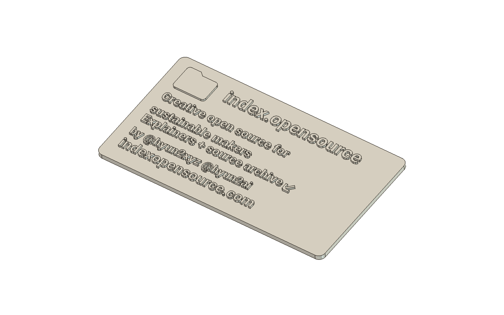

# index.opensource raised-text card

An editable 90 × 50 × 2.6 mm FreeCAD example, derived from the supplied public Instagram profile. `build_card.py` creates a document and prints a geometry report; it makes no network, slicer, or printer calls and writes no files. It refuses an existing document named `IndexOpensourceCardV01`.



## Build in FreeCAD

Set the checkout path in the FreeCAD Python console. This uses the bundled fonts rather than depending on fonts installed in the operating system:

```python
from pathlib import Path
example = Path("/path/to/freecad-bambu-mcp/examples/raised-card")
script = example / "build_card.py"
exec(compile(script.read_text(encoding="utf-8"), str(script), "exec"),
     {"CARD_FONT_DIR": str(example / "fonts")})
```

The document is `IndexOpensourceCardV01`; the printable object is `PrintableCard`. The spreadsheet drives base dimensions and relief extrusion length. Text and logo placement are a fixed layout: after changing dimensions or text, recheck margins, overlaps, final shape, and the slice. A bold font and a fused base help keep small characters attached, but do not guarantee physical strength.

## Use the MCP pipeline

FreeCADMCP executes source without setting `__file__`. Save the console snippet above as a **local** wrapper such as `raised-card.local.py` inside the configured workspace. Copy `examples/plate-job.json` to `raised-card.local.json` and replace its `cad` entry:

```json
{
  "script": "raised-card.local.py",
  "document": "IndexOpensourceCardV01",
  "objects": ["PrintableCard"]
}
```

Keep the actual printer and hardware fields consistent with your local configuration. Run `prepare` with that local spec to build and export, or set `cad.script` to `null` if the document was already built in the console. Continue through GUI slicing, preview, hardware checks, and the usual reviewed lifecycle. This source example does not contain a reusable sliced job.

For the same controlled STL tessellation used in the original card, run this after building in FreeCAD, with a new output directory:

```python
from pathlib import Path
import FreeCAD as App
import MeshPart, Part
out = Path("/path/to/new-card-export")
out.mkdir(parents=True, exist_ok=False)
doc = App.getDocument("IndexOpensourceCardV01")
card = doc.getObject("PrintableCard")
doc.saveCopy(str(out / "model.FCStd"))
mesh = MeshPart.meshFromShape(Shape=card.Shape, LinearDeflection=0.025,
                              AngularDeflection=0.12, Relative=False)
mesh.write(str(out / "model.stl"))
Part.export([card], str(out / "model.step"))
```

`prepare` uses the pipeline's standard `Mesh.export`; the explicit snippet uses a 0.025 mm chord tolerance and 0.12 rad angular deflection. The original GUI build and a headless rebuild had different facet counts, so check the resulting mesh and slice after export.

## Design decisions and sources

- The 1.8 mm base stays flat; the four vertical corners have a 2.4 mm radius. Every text extrusion and the logo overlap the base by 0.1 mm and project 0.8 mm above it. Every source relief is checked for positive intersection before fusion into one closed, valid solid.
- The account name, full introduction, archive line and arrow, author handles, and website are retained. Profile statistics and the cropped trailing sentence are omitted. The first introduction line wraps onto two lines without stretching the glyphs.
- [FreeCAD ShapeString](https://github.com/FreeCAD/FreeCAD-documentation/blob/main/wiki/Draft_ShapeString.md) supports editable font outlines and extrusion. This example uses native Part, Sketcher, Draft, and Spreadsheet features; it adds no CAD runtime dependency.
- [Roboto-2](https://github.com/googlefonts/roboto-2) provides the static Bold and Black fonts. Small body text uses Black weight. The original font files and license are retained in `fonts/`.
- [Prusa's FFF modeling guide](https://help.prusa3d.com/article/modeling-with-3d-printing-in-mind_164135) informed the checks for thin features, closed geometry, and print orientation. Its sample extrusion widths are not assumed to be A1 settings.
- [Bambu Studio's Arachne implementation](https://github.com/bambulab/BambuStudio/blob/master/src/libslic3r/Arachne/WallToolPaths.cpp) was reviewed for variable-width wall behavior. The original slice used Arachne, a 0.4 mm nozzle, PLA, and a textured PEI plate, with relief facing up and supports disabled. Actual last-layer extrusion was checked rather than inferring printability from glyph size alone.
- [CadQuery text](https://cadquery.readthedocs.io/en/latest/classreference.html#cadquery.Workplane.text), [build123d Text](https://build123d.readthedocs.io/en/latest/objects.html#text), and [OpenSCAD](https://openscad.org/cheatsheet/) were compared. The already installed FreeCAD workflow retained the requested editable native document without a second CAD runtime. Their source code was not copied.

Whole-outline `makeOffset2D` triggered an OCCT crash during exploration. The final source uses thicker fonts and normal extrusion instead. A later macOS Qt accessibility crash closed the GUI after saving; the saved CAD and slice were independently checked. These observations are specific to the installed FreeCAD 1.1.3 environment.

## Recorded checks

The original CAD was one closed, valid solid with volume `8570.380195808157 mm³`. Its controlled STL had 150,498 facets and every edge belonged to exactly two faces. The original slice retained extrusion for all 125 separate top relief regions, across 16 layers. Estimated time was 37m24s and estimated material was 10.48 g. The raster coverage check establishes toolpath presence, not physical strength or full G-code safety.

The portable source was rebuilt independently with the installed FreeCAD 1.1.3 native Python runtime, without the GUI. It produced the same exact CAD dimensions and volume, and one closed, valid solid. Its controlled mesh was solid, with 150,474 facets and volume `8569.6171875 mm³`; this regenerated mesh was not the artifact used for the recorded print.

On 2026-10-13 one card was sent once through official Bambu Studio LAN printing to an A1. The same filename was observed during actual printing and at 100%, 16/16 layers, completed. Camera inspection showed one card and raised text rows. Fine-letter legibility, strength, dimensions, and underside quality remain unverified. This does not verify this package's experimental MQTT/FTPS dispatch; see [verification](../../docs/verification.md).
